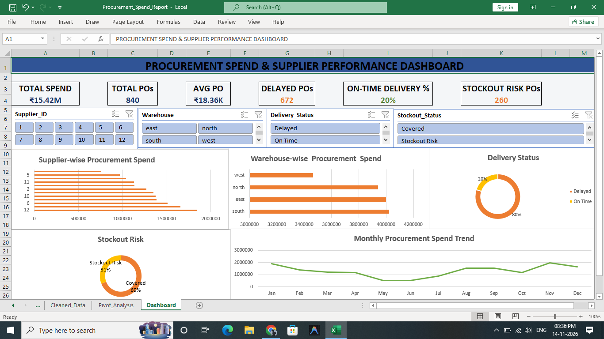

# Procurement Spend & Supplier Performance Analysis

## Project Overview

This project analyzes procurement purchase-order data using Microsoft Excel to understand supplier spending, warehouse-level procurement, delivery performance, stockout risk, and monthly spending trends.

The project demonstrates practical Excel data analysis and dashboarding skills using Power Query, Pivot Tables, Pivot Charts, and interactive slicers.

## Tools & Skills

- Microsoft Excel
- Power Query
- Pivot Tables
- Pivot Charts
- Slicers
- Excel formulas
- Data cleaning and transformation
- Dashboard development
- Procurement analytics

## Project Workflow

Raw Data → Power Query → Clean Data → Pivot Analysis → Dashboard

## Key Analysis

The dashboard provides insights into:

- Total procurement spend
- Total purchase orders
- Average purchase-order value
- Supplier-wise procurement spend
- Warehouse-wise procurement spend
- Delayed purchase orders
- On-time delivery performance
- Stockout risk
- Monthly procurement spending trends

## Dashboard

## Key KPIs

The dashboard includes:

- **Total Spend:** ₹15.42M
- **Total POs:** 840
- **Average PO Value:** ₹18.36K
- **Delayed POs:** 672
- **On-Time Delivery:** 20%
- **Stockout Risk POs:** 260

## Interactivity

Interactive slicers allow users to filter the dashboard by:

- Supplier
- Warehouse
- Delivery Status
- Stockout Status

The charts and KPI values update based on the selected filters.

## Excel Data Preparation

Power Query was used to transform the raw purchase-order data and create analysis-ready fields including:

- Delivery Status
- Stockout Status
- Standardized column names
- Cleaned procurement fields

## Business Questions

The analysis helps answer:

1. Which suppliers account for the highest procurement spend?
2. Which warehouses have the highest procurement spend?
3. How many purchase orders were delayed?
4. What percentage of orders were delivered on time?
5. How many purchase orders have stockout risk?
6. How does procurement spending change over time?

## Project Outcome

The project demonstrates how Excel can be used to transform raw procurement data into an interactive management dashboard for monitoring supplier spending and operational performance.
